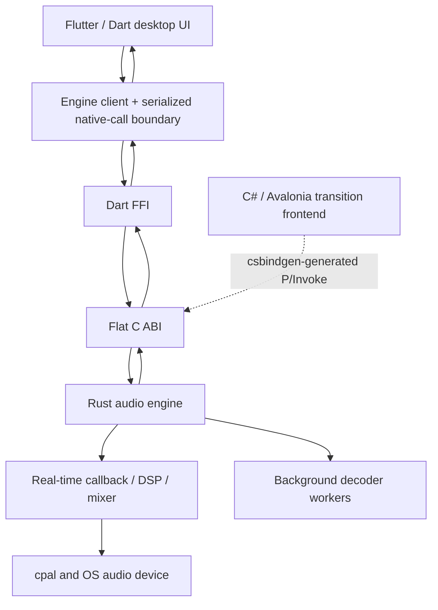

# 🌌 Aetherband

> **A modern, open-source desktop Digital Audio Workstation engineered for flow, speed, and hard real-time precision.**

Aetherband bridges the gap between intuitive songwriting sketchpads and high-precision production environments. It combines the immediate, distraction-free workflow of modern creative apps with the reliability, timing discipline, and low-latency control demanded by serious audio work.

---

## Technology stack and frontend direction

| Layer | Technology | Role / status |
|---|---|---|
| **Audio engine and DSP** | Rust (2021 edition, stable toolchain) | Native engine, decoders, real-time mixer and audio-device callbacks |
| **Native interoperability** | Flat C ABI under `bindings/c_abi/` | Required shared boundary between the Rust engine and desktop UI runtimes |
| **Target desktop UI** | **Flutter + Dart** | Mandatory full-scale Windows/macOS frontend direction; currently a UI-only prototype being integrated through Dart FFI |
| **Dart/native interop** | Dart `dart:ffi` adapter over the C ABI | Production adapter still needs implementing; do not bind Flutter to private Rust internals |
| **Existing transition UI** | C# / .NET 10 + Avalonia | Existing audio-connected desktop frontend, retained until Flutter reaches real-engine feature parity and passes migration gates |
| **C# bindings** | `csbindgen` | Currently generates P/Invoke bindings for the Avalonia app; it does not generate Dart bindings |
| **Audio I/O** | `cpal` | Platform audio output |
| **Decoding** | `symphonia` | WAV playback has been tested; FLAC/MP3/OGG/AAC-M4A are expected candidates but remain unverified end-to-end |
| **Resampling / concurrency** | `rubato`, `rtrb` | Sample-rate conversion and SPSC queues |
| **License** | GPLv3 | Open source |

**Product decision (2026-10-17): Flutter is the long-term desktop UI and must be implemented full scale.** This direction is not optional unless the project owner explicitly changes it. Rust remains the audio engine; Flutter must use the C ABI. Avalonia remains available during the staged migration, but it is not the intended final frontend. See [the Flutter migration plan](docs/FLUTTER_DESKTOP_MIGRATION.md) and [AI handoff](docs/AI_HANDOFF.md).

**Status distinction:** The Flutter preview currently shows simulated transport, clips/waveforms, meters, and instrument state. It does not yet play, record, decode, or export audio. The C#/Avalonia app is still the existing audio-connected desktop UI while the new Dart FFI adapter and end-to-end Flutter engine integration are built.

---

> [!WARNING]
> ### Work in Progress (Early Alpha)
> Aetherband is under active, rapid development and is currently in **early alpha**.
> - APIs, project formats, and interfaces are evolving quickly and subject to breaking changes.
> - Core audio playback and multi-track mixing are implemented. Transport Stop has been fixed in the core (decoder restart + regression test); keep hardware/runtime verification status explicit.
> - Advanced features (MIDI recording, plugin hosting, automation, and project saving) are still in development.
> - **Not recommended for production work yet.** Use it to test, experiment, and contribute!

---

## What Can It Do Right Now? (For the Average User)

If you download and run Aetherband today, here is an honest, plain-English breakdown of what is working versus what is still being built:

### What You Can Do Right Now:
- **Import Audio Files:** WAV playback has been tested. FLAC, MP3, OGG, and AAC/M4A may work through the existing `symphonia` decoding pipeline, but have not yet been verified end-to-end.
- **Automatic Format & Sample Rate Conversion:** Mix audio files of different sample rates (e.g. 44.1 kHz, 48 kHz, 96 kHz) together—the engine resamples them seamlessly in the background.
- **Multi-Track Playback:** Play, pause, and stop playback of all loaded tracks simultaneously in sync.
- **Track Mixing Controls:**
  - Adjust volume faders per track with real-time dB readouts and click-free volume smoothing.
  - Pan tracks left, right, or center with an equal-power stereo balance law.
  - Mute/unmute individual tracks on the fly.
  - Remove unwanted tracks from the session.
- **Master Bus Control & Metering:** Control master volume and monitor real-time stereo peak/RMS VU meters updating smoothly at 60 FPS.
- **Audio Device Selection:** Switch output devices (headphones, speakers, audio interfaces) directly from the top transport bar without restarting.

### What It Cannot Do Yet (Under Active Development):
- **No Saving or Loading Projects:** You cannot save your session to disk yet (session state resets when closing the app).
- **No Audio Recording:** Microphone/instrument audio recording via inputs is planned for Phase 4.
- **Flutter waveform integration:** The existing Avalonia app has an offline waveform peak-generation path, but the Flutter prototype still displays synthetic demo waveforms and is not yet connected to real file/peak data.
- **No MIDI, Virtual Instruments, or Piano Roll:** MIDI keyboard input, software synths, and sequencing will come in Phase 5.
- **No VST3 / CLAP / AU Plugins:** Audio effect and instrument plugin hosting will be introduced in Phase 6.
- **No Automation Curves:** Volume/pan cannot be automated along a curve yet.
- **No Exporting to WAV/MP3 ("Bounce/Render"):** Offline mixdown rendering is not yet implemented.

---

## Current Milestone: Stabilization Gate (Phases 1–3)

The core engine, file playback, multi-track mixing, native interop, and initial timeline UI are implemented. Transport Stop has been fixed at the engine level (see issue #5): on Stop the audio thread silences output and resets the playhead, and the control thread restarts every track’s StreamDecoder so the next Play begins at the start of the file. A regression test asserts silence + playhead zero after Stop. Runtime/hardware verification should be reported separately from automated test coverage.

- [x] **Zero-Allocation Audio Thread:** Hardware callback loop executing on dedicated OS audio thread with guaranteed zero heap allocations.
- [x] **Hardware Audio Driver Support:** Low-latency device discovery and output stream management via `cpal` (WASAPI on Windows, CoreAudio on macOS).
- [x] **Background Disk Streaming & Decoding:** Non-blocking file decoding worker utilizing `symphonia`. WAV playback has been tested; FLAC, MP3, OGG, and AAC/M4A are expected candidates based on decoder support but remain unverified end-to-end.
- [x] **Real-Time Sample Rate Conversion:** High-fidelity sinc/FFT resampling powered by `rubato`.
- [x] **64-Track Summing Mixer:** Real-time multi-track engine featuring Equal-Power stereo panning law and 256-sample de-zippering gain ramping.
- [x] **Lock-Free Concurrency:** Single-Producer Single-Consumer (SPSC) ring buffers (`rtrb`) for wait-free UI ⇄ Audio communications.
- [x] **Automated Safety Test Harness:** Allocation-safety test harness for continuous callback processing; run the repository's current verification commands to validate the present baseline.
- [x] **Flat C-ABI & Automated Bindings:** Clean C99 FFI with automated type-safe C# P/Invoke generation (`csbindgen`).
- [x] **Existing audio-connected transition app:** Hardware-accelerated UI built with **.NET 10 + Avalonia**, featuring multi-track lanes, track controls, playhead and transport. This remains available during Flutter migration.
- [ ] **Target desktop frontend:** Full-scale Flutter/Dart DAW UI connected to the Rust engine through Dart FFI over the C ABI. The visual prototype exists, but native audio integration and feature parity are not complete.
- [x] **Stop transport correctness (core):** Stop silences output, resets playhead, and restarts decoders so Play after Stop restarts from the beginning (regression test present).

---

## Highlights

- **Hard Real-Time Audio Engine:** Engineered in pure **Rust** with zero-allocation audio callbacks and wait-free concurrency (`rtrb`), eliminating dropouts, clicks, and priority inversions.
- **Frontend migration:** Flutter is the mandatory target UI with the compact DAW/IDE-oriented layout in `prototypes/aetherband-flutter-ui/`. The existing C#/Avalonia frontend remains the transition audio-connected app until the Flutter engine adapter and feature parity are verified.
- **Desktop-First Precision:** Designed specifically for desktop workflows—dense mixer strips, multi-monitor layouts, keyboard shortcuts, and sample-accurate editing.
- **Self-Contained Projects:** Portable `.dawproject` format planned to bundle project metadata and audio assets, eliminating "missing audio file" headaches.
- **Open-Source & Extensible:** Free software under the GPLv3 license, built with a clean modular separation between core DSP and UI presentation.

---

## Architecture at a Glance

**Target desktop architecture (required):**



- **Target frontend:** Flutter/Dart, with a dedicated adapter using the same exported C ABI.
- **Audio engine:** Rust owns decoding, device I/O, DSP, mixing and the audio callback.
- **Interop boundary:** `bindings/c_abi/src/lib.rs` is the source of truth for exported functions and `#[repr(C)]` layouts.
- **Temporary legacy frontend:** C#/.NET + Avalonia stays intact until Flutter has real-engine feature parity and the migration acceptance criteria pass.
- **Do not infer functionality from the prototype:** current Flutter telemetry and audio clips are mock data, not native playback.

See [`docs/FLUTTER_DESKTOP_MIGRATION.md`](docs/FLUTTER_DESKTOP_MIGRATION.md) for the staged implementation plan and current ABI inventory.

---

## Repository Structure

```
Aetherband/
├── Cargo.toml                       # Root Rust workspace (core + bindings)
├── core/                            # Pure Rust audio engine & DSP library
│   ├── src/
│   │   ├── audio.rs                 # Allocation-free audio callback processor & mixer
│   │   ├── decoder.rs               # Background disk streaming & file decoder (symphonia)
│   │   ├── device.rs                # Hardware discovery & cpal stream backend
│   │   ├── dsp.rs                   # Sine oscillator, gain ramp, level meter
│   │   ├── ringbuf.rs               # Lock-free SPSC queues (rtrb)
│   │   ├── track.rs                 # Real-time TrackPlayer & TrackSlots
│   │   └── lib.rs                   # High-level DAWEngine controller
│   └── tests/
│       └── realtime_safety.rs       # 100,000-block zero-allocation test harness
├── bindings/
│   └── c_abi/                       # Flat C-ABI export layer (daw_core.dll)
│       └── build.rs                 # Runs csbindgen to generate C# bindings
├── apps/
│   └── desktop/                     # Existing Avalonia transition UI (.NET 10; audio-connected)
│       └── RouletteStudio.Desktop/   # Historical project/namespace name
├── prototypes/
│   └── aetherband-flutter-ui/       # Mandatory target UI under development; currently mock-only
├── docs/                            # Architecture, mandatory Flutter migration plan and AI handoff
└── tools/                           # Automated build and execution scripts
    ├── build.ps1                    # One-command Rust + C# build script
    └── run.ps1                      # Builds and launches the desktop app
```

> **Note on naming:** The desktop project folder and some C# namespaces still use the historical name `RouletteStudio`. Functionally everything is Aetherband; a future cleanup can rename the folder and namespaces without changing behaviour.

---

## Getting Started

### Prerequisites
1. **Rust Toolchain:** [rustup.rs](https://rustup.rs/) (stable MSVC on Windows).
2. **.NET 10 SDK:** [.NET 10 Download](https://dotnet.microsoft.com/download).
3. **Visual Studio:** Visual Studio 2022/2026 with *.NET desktop development* and *Desktop development with C++* workloads.

### Build Everything
Run the automated build script from PowerShell:
```powershell
powershell -ExecutionPolicy Bypass -File .\tools\build.ps1
```

### Launch the existing audio-connected desktop app (transition UI)

```powershell
powershell -ExecutionPolicy Bypass -File .\tools\run.ps1
```

This launches the existing C#/Avalonia app. Keep it as the safe working frontend while Flutter is connected to the real engine; it is not the long-term UI target.

### Run the Flutter desktop UI preview (mock audio only)

Requires Flutter stable plus Visual Studio's **Desktop development with C++** workload on Windows. From the repository root:

```powershell
cd prototypes\aetherband-flutter-ui
flutter pub get
flutter analyze
flutter test
flutter run -d windows
```

On macOS, use Xcode and `flutter run -d macos`. This is still a UI preview; it is not connected to the Rust audio engine. The required Dart FFI integration plan is in [`docs/FLUTTER_DESKTOP_MIGRATION.md`](docs/FLUTTER_DESKTOP_MIGRATION.md).

### Run the Audio Core Test Suite
Run all unit tests and verify the 100,000-block zero-allocation guarantee:
```powershell
cargo test -p daw_core --tests
```

---

## Roadmap Overview

| Phase | Milestone | Status |
|:---:|---|:---:|
| **0** | Architectural Blueprint & Documentation (10 ADRs) | ✅ Complete |
| **1** | Real-Time Audio Core Foundation & Hardware I/O | ✅ Complete |
| **2** | Audio File Playback & Background Disk Streaming | 🧪 Implemented; runtime gate open |
| **3** | Multi-Track Mixer & Interactive Timeline UI | 🧪 Implemented; runtime gate open |
| **3.5** | Transport/lifecycle stabilization and regression tests | 🧪 Mostly implemented; confirm current CI/runtime evidence |
| **UI** | Mandatory full-scale Flutter desktop frontend via C ABI | 🔄 In progress; current UI prototype is mock-only |
| **4** | Audio Recording, waveform peaks, project persistence & export | ⏳ Planned |
| **5** | MIDI Engine, Piano Roll & Virtual Instruments | 📅 Planned |
| **6** | Mixer Routing, Effects Engine & Plugin Hosting | 📅 Planned |

---

## Documentation

Detailed blueprints and architectural specifications:

- [**VISION.md**](docs/VISION.md) — Product vision, target audience, and core principles.
- [**REQUIREMENTS.md**](docs/REQUIREMENTS.md) — Real-time performance and functional requirements.
- [**ARCHITECTURE.md**](docs/ARCHITECTURE.md) — System boundaries, thread boundaries, and data flow.
- [**AUDIO_ENGINE.md**](docs/AUDIO_ENGINE.md) — Real-time thread contract, latency calculations, and mixer design.
- [**API_CONTRACT.md**](docs/API_CONTRACT.md) — Current exported C ABI, structure layouts, return codes, ownership and Dart/C# interop requirements.
- [**ROADMAP.md**](docs/ROADMAP.md) — Complete 6-phase development roadmap.
- [**DECISIONS.md**](docs/DECISIONS.md) — Architecture Decision Records (ADRs).
- [**AI_WORKFLOW.md**](docs/AI_WORKFLOW.md) — AI pair-programming safety procedures.
- [**FLUTTER_DESKTOP_MIGRATION.md**](docs/FLUTTER_DESKTOP_MIGRATION.md) — Mandatory full-scale Flutter target architecture, C ABI integration and migration gates.
- [**AI_HANDOFF.md**](docs/AI_HANDOFF.md) — Work history, precise current state, CI evidence and next priorities.
- [**ENGINEERING_STATUS.md**](docs/ENGINEERING_STATUS.md) — Dated current engineering/verification snapshot.
- [**TECH_STACK.md**](docs/TECH_STACK.md) — Selected tech stack and binding responsibilities.

---

## License

Aetherband is licensed under the [GNU General Public License v3.0 (GPLv3)](LICENSE).
