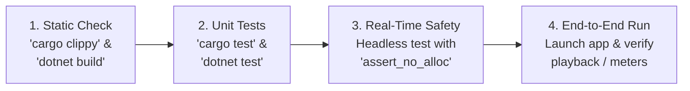

# AI-Assisted Development Workflow & Engineering Safeguards: CustomDAW

## 1. Principles of AI-Assisted Pair Programming

To ensure that AI acceleration does not result in an unmaintainable, buggy, or brittle codebase, all development in this repository must adhere to the **AI Engineering Safeguards**.

The human developer is the architect and project owner. AI assists with research, architectural validation, scaffolding, algorithmic implementation, and test creation.

---

## 2. The 10 Invariant Safeguards

1. **Verify Before Modifying:**
   Always inspect existing files, dependencies, and git status before proposing or applying code changes. Never assume file contents or directory structures.
2. **Strict Architecture Adherence:**
   All code must conform to the approved designs in `docs/ARCHITECTURE.md` and `docs/AUDIO_ENGINE.md`. Never silently introduce new patterns, frameworks, or architectural layers without an ADR.
3. **No Unapproved Dependencies:**
   Do not add new crates to `Cargo.toml` or NuGet packages to `.csproj` files without explicitly explaining the crate's purpose, license, maintenance status, and why standard or existing tools are insufficient.
4. **Zero Compromise on Real-Time Audio Safety:**
   Never introduce heap allocations (`Vec::push`, `Box::new`, `format!`), OS locks (`std::sync::Mutex`), filesystem I/O, or FFI callbacks into the real-time audio thread for developer convenience.
5. **No Blind or Hallucinated Verification:**
   Never state that a piece of code compiled, ran, passed tests, or was benchmarked unless the command was executed directly and the verified terminal output confirmed success.
6. **No Error Suppression:**
   Do not suppress compiler warnings, disable linter rules (`#[allow(warnings)]`), or silence failing tests merely to make a build appear clean. Fix the underlying root cause.
7. **Documented C-ABI Discipline:**
   Any change to exported FFI functions or structs in `bindings/c_abi/` must be paired with re-running `csbindgen` to ensure C# bindings remain synchronized.
8. **Small, Focused Increments:**
   Avoid generating sprawling, multi-thousand-line monolithic files. Break implementations into cohesive, modular components with corresponding unit tests.
9. **Explain the "Why":**
   When introducing low-level audio algorithms, DSP math, or concurrency patterns, provide clear, concise comments explaining the mathematical and engineering rationale.
10. **Data Integrity & Non-Destructive Operations:**
    Never run destructive git operations (`git reset --hard`, `git clean -f`) or delete existing source directories without explicit confirmation.

---

## 3. Coding Standards & Conventions

### 3.1 Rust (`core/` & `bindings/c_abi/`)
- **Edition:** Rust 2021.
- **Formatting:** Enforce with `cargo fmt`.
- **Linting:** Enforce with `cargo clippy -- -D warnings`.
- **Error Handling:** Use `thiserror` for domain-specific errors in the core; return numeric `DAWResult` error codes across the C-ABI. Never call `unwrap()` or `expect()` in code reachable by the audio callback.
- **Real-Time Safety:** Real-time callbacks must pass automated `assert_no_alloc` tests in CI.

### 3.2 C# / .NET (`apps/desktop/`)
- **Framework:** .NET 8 / 9 LTS with C# 12+.
- **Formatting:** Enforce via `.editorconfig` and `dotnet format`.
- **Architecture Pattern:** MVVM (Model-View-ViewModel) using ReactiveUI / CommunityToolkit.Mvvm.
- **Async Pattern:** Use `async/await` for UI events and disk I/O; never call `.Result` or `.Wait()` on UI threads.
- **P/Invoke:** All native interop calls must use generated `NativeMethods.g.cs` structures; no ad-hoc manual DLL imports.

---

## 4. Verification & Testing Procedures

Before declaring any feature or milestone complete, verify against this four-step checklist:



1. **Static Analysis & Linting:**
   ```powershell
   cargo clippy --workspace --all-targets -- -D warnings
   dotnet build apps/desktop/CustomDAW.Desktop.sln
   ```
2. **Automated Unit & DSP Testing:**
   ```powershell
   cargo test --workspace
   dotnet test apps/desktop/CustomDAW.Desktop.sln
   ```
3. **Headless Real-Time Allocation Verification:**
   Run the dedicated real-time test harness to guarantee zero allocations over 100,000 blocks:
   ```powershell
   cargo test --test realtime_safety -- --nocapture
   ```
4. **End-to-End Desktop Verification:**
   Launch the desktop shell, verify audio device enumeration, trigger test tone, adjust fader smoothly, inspect VU meter response, and exit cleanly.
