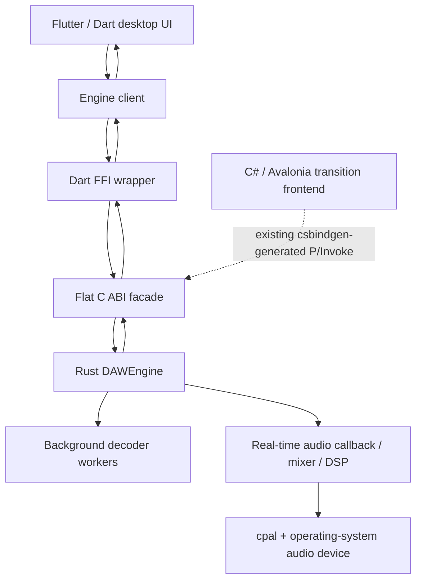

# System Architecture: Aetherband

## 1. Target Architecture — Flutter + Rust via C ABI

**Mandatory product direction (2026-10-17):** implement Flutter/Dart as the full-scale primary desktop UI. The existing C#/Avalonia app is the transition frontend and remains available until the Flutter client has real engine integration and passes feature-parity/release gates. See [`FLUTTER_DESKTOP_MIGRATION.md`](FLUTTER_DESKTOP_MIGRATION.md).

The intended architecture is a decoupled presentation/client layer, native interoperability boundary, and Rust engine:

1. **Flutter presentation layer (Dart):** owns user experience, app menu, timeline editing surface, browser/library, instrument/effect panels, mixer layout, keyboard shortcuts, view state and user preferences.
2. **Dart FFI adapter:** exposes a small typed engine-client interface and calls only exported functions in `bindings/c_abi/src/lib.rs`. It maps ABI layouts, handles and return codes and owns the serialized call boundary.
3. **Flat C ABI:** owns the language-neutral public boundary to the native engine. C-compatible structs and opaque handles are the only native data structures visible to the UI.
4. **Rust native engine:** owns audio processing, DSP, decoding, audio-device I/O, mixer, and all real-time-critical execution.



**Implementation state:** the current Flutter workspace is still mock-only. Its transport, meter values, track/clip models and displayed waveforms are not native engine state. The diagram above is the required target architecture, not a claim that the Dart FFI adapter already exists.

### Native engine remains authoritative

- `core/` owns real-time processing, device streams, decoder workers and mixer state.
- `bindings/c_abi/src/lib.rs` is the authoritative list of exported functions and ABI layouts. Do not copy stale example signatures from older docs.
- `bindings/c_abi/build.rs` runs `csbindgen` for the existing C# frontend. That does not generate Dart bindings.
- If Flutter needs an operation not present in the C ABI, implement/review it on the native side and update the API contract, Dart wrapper, C# generated bindings (where applicable), and tests together.
- Do not implement DSP, file decoding, device callbacks, or raw-audio processing in Dart.

---

## 2. Component Responsibilities & Boundaries

### 2.1 Flutter presentation layer (target; currently under `prototypes/aetherband-flutter-ui/`)
- **Responsibilities:**
  - Render the desktop workstation at interactive refresh rates, with an arrangement-first layout, browser/library, instrument/effect panels, mixer and menus.
  - Keep UI/domain models separate from native engine handles behind an injectable engine-client interface.
  - Reflect native return codes and polled telemetry rather than assuming that a local button state means playback or a mix change succeeded.
  - Store view-only preferences (window layout, recent-file UI, zoom and panel visibility) separately from native audio state.
- **Prohibitions:**
  - **Zero audio processing:** never calculate DSP, decode media, mix samples or manipulate device buffers in Dart.
  - **Zero blocking FFI:** no long-running native or disk operation on the UI isolate.
  - Until concurrency guarantees are redesigned and tested, serialize calls for one engine handle through one owner boundary/isolate.
  - Do not ship the mock engine as if it were a real audio backend.

### 2.2 The C-ABI interoperability layer (`bindings/c_abi/`)
- **Responsibilities:**
  - Expose only deliberate `extern "C"` functions and `#[repr(C)]` layouts with documented ownership, return codes and lifetimes.
  - Provide opaque `DAWEngine` handles and ensure native allocations/resources are released through Rust exports.
  - Keep the actual function inventory in `bindings/c_abi/src/lib.rs` synchronized with `docs/API_CONTRACT.md` and the Dart adapter tests.
  - Continue generating C# P/Invoke declarations with `csbindgen` for the legacy frontend until it is retired.
- **Prohibitions:**
  - Do not pass C#/Dart objects, closures, UI handles or Rust internals across the boundary.
  - Do not move continuous raw audio samples through UI event handlers.
  - Do not assume `csbindgen` generates Dart bindings; Dart requires its own adapter.

### 2.3 The Core Engine (`core/`)
- **Responsibilities:**
  - Owning the audio device stream (`cpal` backend) and managing stream life-cycle.
  - Managing lock-free Single-Producer Single-Consumer (SPSC) ring buffers.
  - Scheduling sample-accurate events (e.g., volume ramps, playback start/stop).
  - Pre-allocating all audio buffers and lookup tables ahead of time.
  - Decoding audio files asynchronously on worker threads.
- **Sub-modules:**
  - `core::audio`: Processing graph, channel routing, buffer slicing.
  - `core::dsp`: Pure mathematical functions (oscillators, biquad filters, gain ramping, peak/RMS detectors).
  - `core::device`: Abstraction over OS audio APIs.
  - `core::transport`: Musical time, sample counters, tempo.
  - `core::ringbuf`: Thread-safe, wait-free ring buffer implementations.
  - `core::project`: Serializable schema and state models.

---

## 3. Data Flow Architecture

The system segregates data into three strictly isolated pipelines:

```
┌────────────────────────────────────────────────────────────────────────┐
│                        THREE SEPARATE DATA PIPELINES                   │
├─────────────────────┬──────────────────────┬───────────────────────────┤
│  1. Control Path    │  2. Telemetry Path   │  3. Audio Pipeline        │
│  (UI ➔ Engine)      │  (Engine ➔ UI)       │  (Disk ➔ DSP ➔ Hardware)  │
├─────────────────────┼──────────────────────┼───────────────────────────┤
│ UI Thread produces  │ Audio thread pushes  │ Disk worker pre-buffers   │
│ commands (Play, Pan)│ peak/RMS values to   │ samples into RAM.         │
│ to SPSC ring buffer.│ SPSC ring buffer.    │ Audio thread pulls blocks,│
│ Audio thread pops   │ UI timer polls ring  │ mixes without locks, and  │
│ without blocking.   │ buffer at 60Hz.      │ writes to output device.  │
└─────────────────────┴──────────────────────┴───────────────────────────┘
```

### 3.1 Control Flow (Downstream: UI to Audio Thread)
1. User drags Master Volume slider to -6.0 dB.
2. ViewModel constructs `EngineCommand::SetMasterVolume { target_gain: 0.501, ramp_frames: 256 }`.
3. P/Invoke passes this small C-struct to `daw_engine_send_command()`.
4. Rust core pushes the struct into the lock-free `CmdQueue`. If full, the command is safely dropped or logged without stalling.
5. In the next audio callback block, the audio thread pops all pending commands from `CmdQueue` and updates its internal gain parameter.

### 3.2 Telemetry Flow (Upstream: Audio Thread to UI)
1. At the end of processing an audio block (e.g., every 128 samples), the audio thread computes the peak sample and running RMS power for Left and Right channels.
2. The audio thread pushes a `MeteringFrame { peak_l, peak_r, rms_l, rms_r, playhead_frame }` struct into `TelemetryQueue`.
3. If the queue is full (e.g., UI is busy), the oldest frame is overwritten (lossy telemetry is completely acceptable; audio safety is paramount).
4. The Flutter engine client polls `daw_engine_poll_telemetry()` at a bounded UI cadence to update meters and playhead. The existing Avalonia frontend may continue using its current timer during the transition. Never busy-loop or race calls on the same native handle.

### 3.3 Audio Streaming Pipeline
1. Audio files are opened by a background `DiskReaderWorker` thread.
2. The worker thread decodes audio chunks into pre-allocated memory arenas.
3. The real-time audio thread reads from this pre-filled arena.
4. Under no circumstances does the audio thread ever open a file, read a byte from disk, or allocate memory.

---

## 4. Key Architectural Trade-Offs & Decisions

| Decision | Alternative Considered | Chosen Approach | Rationale |
| :--- | :--- | :--- | :--- |
| **Separation of Mobile & Desktop** | Single UI optimized for desktop and mobile at once | **Flutter desktop-first flagship; consider mobile as a separate effort later** | Allows a high-density desktop workstation without delaying the desktop migration for touch-first/mobile requirements. |
| **Language Selection** | Pure C++20 or managed audio/DSP | **Rust (engine) + Flutter/Dart (target UI)** | Keeps real-time engine execution native; Flutter owns presentation/control through the flat C ABI. Existing C# remains transitional. |
| **Audio Thread Communication** | Shared `Arc<Mutex<EngineState>>` | **Lock-Free SPSC Queues (`rtrb`)** | Standard mutexes cause priority inversions and audio xruns. Lock-free queues guarantee deterministic real-time execution. |
| **Plugin Architecture** | Immediate VST3 hosting | **Built-in DSP first; defer external plugins to Phase 5** | VST3 hosting is notoriously complex, prone to third-party crashes, and legally complicated. Built-in DSP guarantees stability. |
| **Serialization Format** | Monolithic binary blob | **Standard JSON / MessagePack metadata + assets folder inside zip** | Readable, robust against version changes, easy to inspect and debug, highly portable. |
