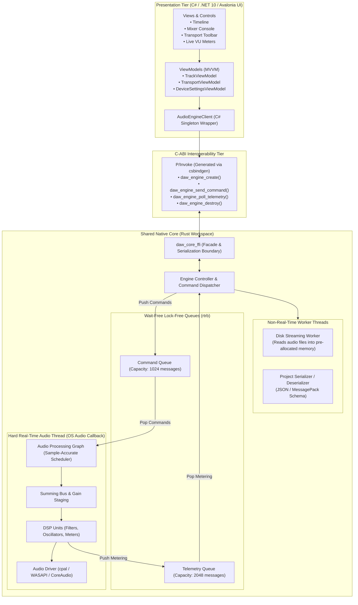

# System Architecture: Aetherband

## 1. High-Level Architectural Overview

Aetherband is architected as a **decoupled, two-tier system**:
1. **The Shared Native Core (`daw_core` in Rust):** Owns all audio processing, DSP algorithms, audio driver I/O, lock-free ring buffers, sample-accurate transport scheduling, disk streaming, and project serialization.
2. **The Desktop Presentation Layer (`Aetherband.Desktop` in C# / Avalonia UI):** Owns windowing, user input, timeline graphics, zooming/scrolling, MVVM data binding, and desktop integration.

The boundary between these tiers is a **Flat, Versioned C-ABI** exposed by `daw_core_ffi`.



---

## 2. Component Responsibilities & Boundaries

### 2.1 The Presentation Layer (`apps/desktop/`)
- **Responsibilities:**
  - Rendering UI at 60–144 Hz using hardware-accelerated Skia.
  - Translating user actions (button clicks, fader drags, keyboard shortcuts) into strongly-typed `EngineCommand` structures.
  - Polling engine telemetry (playback position, stereo meters) via a 60 Hz timer loop and updating ViewModels.
  - Storing user interface preferences (window layout, recent files, zoom levels).
- **Prohibitions:**
  - **Zero audio processing:** Must never attempt to calculate DSP, filter audio, or manipulate audio samples.
  - **Zero blocking FFI:** Must never execute long-running blocking calls into the native core on the UI thread.

### 2.2 The C-ABI Interoperability Layer (`bindings/c_abi/`)
- **Responsibilities:**
  - Exposing an `extern "C"` interface with strict `#[no_mangle]` function exports.
  - Providing opaque pointers (`*mut DAWEngine`) to manage lifetime and encapsulation.
  - Ensuring consistent memory layout (`#[repr(C)]`) across compilers.
  - Generating C# binding definitions automatically using `csbindgen`.
- **Prohibitions:**
  - Must never pass complex managed objects (e.g., C# classes or delegates) across the boundary.
  - Must never pass continuous streams of raw audio buffers across FFI.

### 2.3 The Core Engine (`core/`)
- **Responsibilities:**
  - Owning the audio device stream (`cpal` backend) and managing stream life-cycle.
  - Managing lock-free Single-Producer Single-Consumer (SPSC) ring buffers.
  - Scheduling sample-accurate events (e.g., volume ramps, playback start/stop).
  - Pre-allocating all audio buffers and lookup tables ahead of time.
  - Decoding audio files asynchronously on worker threads.
- **Sub-modules:**
  - `core::audio`: Processing graph, channel routing, buffer slicing.
  - `core::dsp`: Pure mathematical functions (oscillators, biquad filters, gain ramping, peak/RMS detectors).
  - `core::device`: Abstraction over OS audio APIs.
  - `core::transport`: Musical time, sample counters, tempo.
  - `core::ringbuf`: Thread-safe, wait-free ring buffer implementations.
  - `core::project`: Serializable schema and state models.

---

## 3. Data Flow Architecture

The system segregates data into three strictly isolated pipelines:

```
┌────────────────────────────────────────────────────────────────────────┐
│                        THREE SEPARATE DATA PIPELINES                   │
├─────────────────────┬──────────────────────┬───────────────────────────┤
│  1. Control Path    │  2. Telemetry Path   │  3. Audio Pipeline        │
│  (UI ➔ Engine)      │  (Engine ➔ UI)       │  (Disk ➔ DSP ➔ Hardware)  │
├─────────────────────┼──────────────────────┼───────────────────────────┤
│ UI Thread produces  │ Audio thread pushes  │ Disk worker pre-buffers   │
│ commands (Play, Pan)│ peak/RMS values to   │ samples into RAM.         │
│ to SPSC ring buffer.│ SPSC ring buffer.    │ Audio thread pulls blocks,│
│ Audio thread pops   │ UI timer polls ring  │ mixes without locks, and  │
│ without blocking.   │ buffer at 60Hz.      │ writes to output device.  │
└─────────────────────┴──────────────────────┴───────────────────────────┘
```

### 3.1 Control Flow (Downstream: UI to Audio Thread)
1. User drags Master Volume slider to -6.0 dB.
2. ViewModel constructs `EngineCommand::SetMasterVolume { target_gain: 0.501, ramp_frames: 256 }`.
3. P/Invoke passes this small C-struct to `daw_engine_send_command()`.
4. Rust core pushes the struct into the lock-free `CmdQueue`. If full, the command is safely dropped or logged without stalling.
5. In the next audio callback block, the audio thread pops all pending commands from `CmdQueue` and updates its internal gain parameter.

### 3.2 Telemetry Flow (Upstream: Audio Thread to UI)
1. At the end of processing an audio block (e.g., every 128 samples), the audio thread computes the peak sample and running RMS power for Left and Right channels.
2. The audio thread pushes a `MeteringFrame { peak_l, peak_r, rms_l, rms_r, playhead_frame }` struct into `TelemetryQueue`.
3. If the queue is full (e.g., UI is busy), the oldest frame is overwritten (lossy telemetry is completely acceptable; audio safety is paramount).
4. An Avalonia 60 Hz dispatcher timer calls `daw_engine_poll_telemetry()`, reading the latest frame to animate VU meter bars and update the timeline playhead.

### 3.3 Audio Streaming Pipeline
1. Audio files are opened by a background `DiskReaderWorker` thread.
2. The worker thread decodes audio chunks into pre-allocated memory arenas.
3. The real-time audio thread reads from this pre-filled arena.
4. Under no circumstances does the audio thread ever open a file, read a byte from disk, or allocate memory.

---

## 4. Key Architectural Trade-Offs & Decisions

| Decision | Alternative Considered | Chosen Approach | Rationale |
| :--- | :--- | :--- | :--- |
| **Separation of Mobile & Desktop** | Single unified codebase running Avalonia or Qt on both desktop and mobile | **Desktop-first flagship (C#/Avalonia), separate future mobile DAW** | Avoids compromise in desktop density/power; eliminates iOS build friction during initial development while keeping core engine 100% reusable. |
| **Language Selection** | Pure C++20 | **Rust (Core) + C# (Desktop UI)** | Eliminates C++ memory corruption risks and build-system chaos while utilizing developer's C# strength. |
| **Audio Thread Communication** | Shared `Arc<Mutex<EngineState>>` | **Lock-Free SPSC Queues (`rtrb`)** | Standard mutexes cause priority inversions and audio xruns. Lock-free queues guarantee deterministic real-time execution. |
| **Plugin Architecture** | Immediate VST3 hosting | **Built-in DSP first; defer external plugins to Phase 5** | VST3 hosting is notoriously complex, prone to third-party crashes, and legally complicated. Built-in DSP guarantees stability. |
| **Serialization Format** | Monolithic binary blob | **Standard JSON / MessagePack metadata + assets folder inside zip** | Readable, robust against version changes, easy to inspect and debug, highly portable. |
