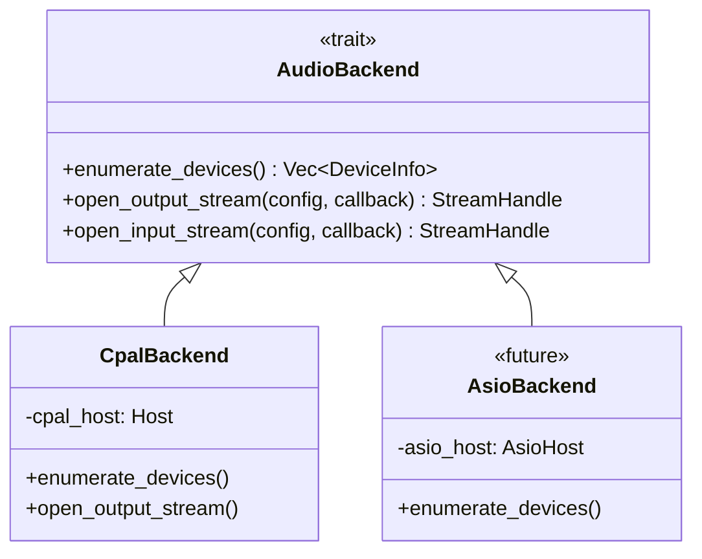

# Aetherband Audio Engine Specification: Aetherband

## 1. Real-Time Audio Constraints (The Real-Time Thread Contract)

The audio callback executes on a high-priority, real-time operating system thread scheduled directly by the audio subsystem (WASAPI on Windows, CoreAudio on macOS). To guarantee audio continuity without audible dropouts (xruns), the audio callback must adhere to the **Real-Time Thread Contract**.

### 1.1 Prohibited Operations on the Audio Thread
1. **NO Memory Allocation or Deallocation:**
   - Any invocation of `malloc`, `free`, `realloc`, or Rust constructs like `Vec::push`, `Box::new`, `String::from`, `format!` is strictly prohibited.
   - Deallocating memory (e.g., dropping a vector or heap-allocated struct) returns memory to the OS heap and can acquire an internal heap lock; this is strictly prohibited.
2. **NO Blocking Synchronization / Mutexes:**
   - Standard OS mutexes (`std::sync::Mutex`, Windows `CRITICAL_SECTION`, POSIX `pthread_mutex`) risk **priority inversion**—where the real-time audio thread waits on a low-priority UI thread holding the lock.
   - Only lock-free, wait-free atomic operations and Single-Producer Single-Consumer (SPSC) ring buffers are permitted.
3. **NO Filesystem or Disk I/O:**
   - Reading or writing to disk can stall for tens or hundreds of milliseconds due to OS page cache misses, disk spin-up, or background paging.
4. **NO Operating System or Network Calls:**
   - Logging (`println!`, logging frameworks that write to files or console), socket operations, and time-query syscalls are prohibited.
5. **NO FFI Calls into UI/Managed Runtimes:**
   - Calling back into C#, Avalonia, Flutter/Dart, Swift, or another UI runtime from the audio thread is forbidden. The audio callback must not wait for UI work, trigger managed-runtime callbacks, or depend on UI object lifetime.

### 1.2 Real-Time Verification
In continuous integration and debug test suites, the real-time audio callback is wrapped using the `assert_no_alloc` crate. Any accidental allocation inside the audio loop triggers an immediate assertion panic during automated testing.

---

## 2. Latency Anatomy & Math

Audio latency is often misunderstood. A block size of 128 frames does **not** represent the total round-trip latency. Total latency is the sum of multiple pipeline stages:

$$T_{\text{total}} = T_{\text{input\_hw}} + T_{\text{input\_buffer}} + T_{\text{dsp\_processing}} + T_{\text{output\_buffer}} + T_{\text{output\_hw}} + T_{\text{dac\_conversion}}$$

### Practical Latency Table at 48,000 Hz

| Buffer Size (Frames) | Block Duration ($T_{\text{block}}$) | Typical Windows WASAPI Shared Round-Trip | Typical Windows WASAPI Exclusive Round-Trip | Typical macOS CoreAudio Round-Trip |
| :--- | :--- | :--- | :--- | :--- |
| **64 frames** | **1.33 ms** | $\approx 25\text{–}35\text{ ms}$ (Resampled by OS) | $\approx 4\text{–}6\text{ ms}$ | $\approx 3.5\text{–}5\text{ ms}$ |
| **128 frames** | **2.67 ms** | $\approx 28\text{–}38\text{ ms}$ | $\approx 6\text{–}9\text{ ms}$ | $\approx 5.5\text{–}7.5\text{ ms}$ |
| **256 frames** | **5.33 ms** | $\approx 33\text{–}43\text{ ms}$ | $\approx 11\text{–}15\text{ ms}$ | $\approx 10\text{–}13\text{ ms}$ |
| **512 frames** | **10.67 ms** | $\approx 44\text{–}55\text{ ms}$ | $\approx 22\text{–}26\text{ ms}$ | $\approx 21\text{–}24\text{ ms}$ |

- **MVP Target:** 256 or 512 frames default for rock-solid stability during initial testing; selectable down to 128 or 64 frames for low-latency live monitoring.

---

## 3. Audio I/O Driver Architecture

`cpal` is used as an OS-level audio stream binding, but it is encapsulated behind our custom `AudioBackend` trait:



### 3.1 Device Management & Disconnection Handling
- During migration, the existing Avalonia client and the target Flutter client request device selection through their respective UI adapters and the C ABI. The native control path owns stream reconfiguration; the audio callback never calls back into either UI runtime.
- The control thread gracefully stops the existing stream, cleans up resources, and opens the new stream.
- If an active device is disconnected by the OS (e.g., USB cable pulled):
  1. `cpal` invokes an error callback (`StreamErrorCallback`).
  2. The error callback catches the device fault, marks the engine as `DeviceLost`, and pushes a notification to the UI via the telemetry ring buffer.
  3. The engine transitions safely to an idle state without crashing.
  4. The UI displays an alert: *"Audio output device disconnected. Select a new device in Preferences."*

---

## 4. Processing Pipeline & Mixer Topology

Within each audio callback block (e.g., 128 frames), processing follows a strict sequential pipeline:

```mermaid
flowchart LR
    Start([Hardware Callback]) --> PopCmds[1. Pop SPSC Commands\nUpdate volumes & state]
    PopCmds --> PullAudio[2. Pull Track Buffers\nFrom pre-allocated ring buffers]
    PullAudio --> ApplyDSP[3. Process Track DSP\nFilters, EQs, gain ramps]
    ApplyDSP --> SumMixer[4. Sum into Master Bus\nApply Equal Power Pan Law]
    SumMixer --> MasterFX[5. Master Bus DSP\nVolume fader & Limiter]
    MasterFX --> ComputeMeters[6. Calculate Peak/RMS\nPush to Telemetry Queue]
    ComputeMeters --> WriteHW([Write to Output Buffer])
```



### 4.1 Sample-Accurate Gain Ramping (Anti-Zipper)
When a user moves a volume fader from $0.0\text{ dB}$ ($g = 1.0$) down to $-6.0\text{ dB}$ ($g \approx 0.501$), jumping directly to $0.501$ produces an audible high-frequency "zipper" pop.
The engine implements linear or exponential gain ramping across $N$ samples:

$$g[n] = g_{\text{current}} + n \cdot \left(\frac{g_{\text{target}} - g_{\text{current}}}{N}\right)$$

Where $N$ is typically 128 to 256 samples ($\approx 2.6\text{–}5.3\text{ ms}$). This ensures completely silent, smooth parameter modulation.

### 4.2 Equal-Power Panning Law
To ensure that an audio track does not sound louder when panned dead-center compared to hard-left or hard-right, we use the standard **-3 dB Equal-Power Panning Law**:

$$g_L(\theta) = \cos\left(\frac{\pi}{2} \cdot \theta\right), \quad g_R(\theta) = \sin\left(\frac{\pi}{2} \cdot \theta\right)$$

Where $\theta \in [0.0, 1.0]$ represents pan position ($0.0 = \text{Full Left}$, $0.5 = \text{Center}$, $1.0 = \text{Full Right}$). At center ($\theta = 0.5$):

$$g_L = \cos\left(\frac{\pi}{4}\right) = \frac{\sqrt{2}}{2} \approx 0.7071 \; (-3.01\text{ dB})$$

---

## 5. Transport stop/reset regression checklist

The original Stop/playhead inconsistency was reported fixed by the maintainer on 2026-10-16, with a regression test documented. Treat this section as enduring acceptance criteria, **not evidence that the bug is currently recurring**. Reopen it only if current tests or runtime observation reproduce a failure.

When validating Stop behavior, verify non-silent playback before Stop, silence after Stop, stopped telemetry with a zero playhead, and successful Play from the beginning afterward. Draining already-decoded ring-buffer blocks does not by itself rewind a decoder source; rewind/restart behavior must be implemented explicitly and tested. Keep decoder restart and resource management on the control/worker side, preserving the real-time callback's no-allocation, no-deallocation, and no-blocking constraints.

## 6. Ring Buffers and Thread Communication

Cross-thread communication relies entirely on the `rtrb` crate (Single-Producer Single-Consumer wait-free ring buffer):

```
┌────────────────────────────────────────────────────────────────────────┐
│                      LOCK-FREE SPSC RING BUFFERS                       │
├────────────────────────────────────────────────────────────────────────┤
│ UI Thread ──[push: max 1024]──► CommandQueue ──[pop]──► Audio Thread   │
│                                                                        │
│ Audio Thread ──[push: max 2048]► TelemetryQueue ──[pop]► UI (60Hz)     │
│                                                                        │
│ Disk Worker ──[push: audio frames]► TrackStreamQueue ──► Audio Thread  │
└────────────────────────────────────────────────────────────────────────┘
```

- **Wait-Free Guarantee:** Neither `push` nor `pop` ever waits on the other thread. If the command queue is full, the command is rejected or buffered in UI memory. If the telemetry queue is full, the oldest meter frame is discarded without impeding audio playback.
