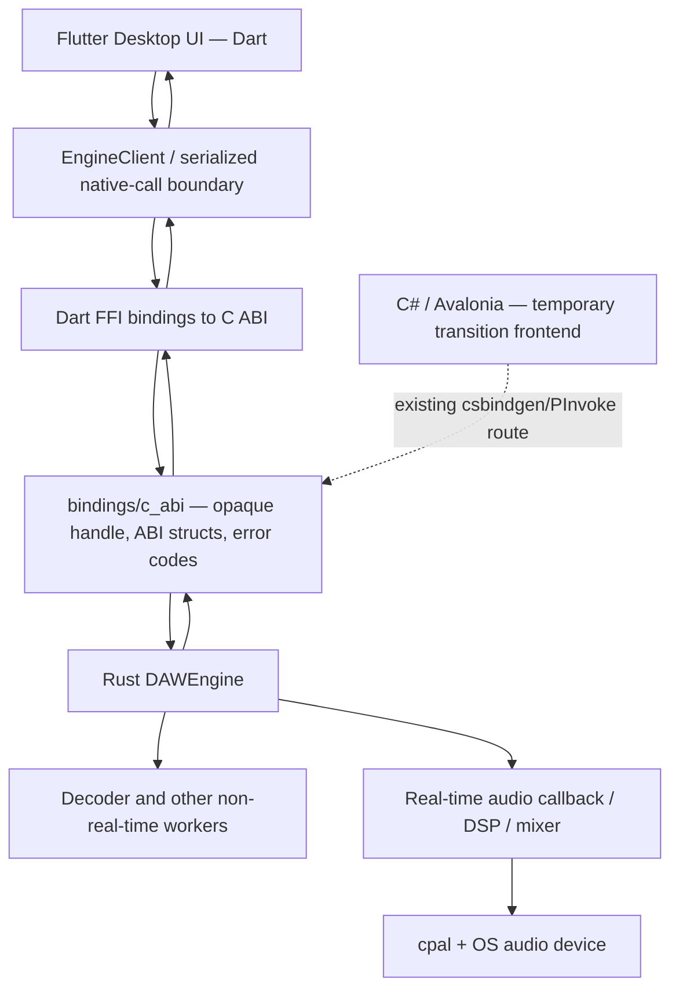

# Flutter Desktop Migration — Canonical Plan

**Decision status:** Approved by the project owner on 2026-10-17  
**Product direction:** Flutter is the mandatory long-term desktop UI for Aetherband. This is not an optional prototype or a short-lived experiment. Complete the migration to a full-scale, daily-usable DAW frontend unless the project owner explicitly reverses this decision.  
**Implementation status:** In progress. The visual prototype is merged, but it is not yet connected to the real audio engine.

Read this document before making frontend, interop, or roadmap decisions. The concise agent contract is in [`AGENTS.md`](../AGENTS.md); the chronological handoff is [`AI_HANDOFF.md`](AI_HANDOFF.md).

## 1. Non-negotiable direction

1. **Build Aetherband's full desktop UI in Flutter/Dart.** Continue through implementation friction, missing widgets, packaging issues, test failures, and platform differences. Fix the problems; do not use them as reasons to abandon Flutter.
2. **Use the existing Rust audio engine through the existing C ABI** in `bindings/c_abi/`. Flutter must call the native engine through Dart FFI (or a separately reviewed, thin bridge that still calls this C ABI). Do not reimplement the engine, DSP, audio callback, file decoder, or mixer in Dart.
3. **The C ABI is the cross-language contract.** Do not let Dart depend on private Rust types, internal Rust crates, C# classes, or generated C# P/Invoke code. If the ABI lacks an operation the UI needs, extend the C ABI deliberately, review its ownership/threading/error contract, and keep its documentation and all maintained bindings synchronized.
4. **Avalonia is transitional, not the long-term product direction.** Keep it buildable while Flutter reaches feature parity and the new UI is verified. Do not delete or break the existing C# app before the migration acceptance criteria below are met. Do not keep two permanent frontends by default.
5. **“Mandatory” does not mean bypassing engineering safeguards.** Do not merge untested changes, silence failures, skip ABI review, risk the real-time audio callback, or declare completion without evidence. Stage the work so the end state is full Flutter implementation without sacrificing correctness.

Only the project owner can supersede this direction.

## 2. Current architecture and migration boundary

### Native side — retain

- `core/`: Rust engine, audio processing, device I/O, decoder workers, and audio-thread communication.
- `bindings/c_abi/src/lib.rs`: current exported C ABI and opaque `DAWEngine` handle.
- `bindings/c_abi/build.rs`: runs `csbindgen` to generate C# bindings into the existing Avalonia project. This generation is C#-specific; it does not generate Dart bindings.
- Existing library crate package is `daw_core_ffi` with native library name `daw_core`. Confirm the exact build output, target triple, and packaging paths from current Cargo configuration before writing automation.

### Flutter side — promote from prototype to the main frontend

Current source directory: `prototypes/aetherband-flutter-ui/`

Important files:

| File | Responsibility |
|---|---|
| `lib/main.dart` | Flutter entry point |
| `lib/src/aetherband_app.dart` | Workspace state, menu/transport layout, pane composition |
| `lib/src/theme.dart` | Palette and theme tokens |
| `lib/src/models.dart` | Current demo-only track/clip models |
| `lib/src/mock_engine.dart` | Fake engine/telemetry; replace behind an adapter, do not treat as production audio |
| `lib/src/widgets/timeline_view.dart` | Track headers, ruler, lanes, clip positioning, volume/mute/solo controls |
| `lib/src/widgets/clip_tile.dart` | Demo clips and drawn synthetic waveform artwork |
| `lib/src/widgets/workspace_panels.dart` | Library browser, instrument preview, knobs, device panel and mixer |
| `test/widget_test.dart` | Workspace/transport smoke test |
| `.github/workflows/flutter-ui-prototype.yml` | Windows/macOS analysis, widget test and debug build CI (workflow is at repository root) |

Do not assume the prototype models, clip waveforms, presets, knobs, track state, mixer, recording status, or telemetry are connected to the Rust engine. A visually plausible control is not a working DAW feature.

### Target architecture



The dotted Avalonia path exists for migration safety only. Flutter is the required target frontend.

## 3. Current C ABI inventory

The source of truth is the actual exported functions in `bindings/c_abi/src/lib.rs`, not stale example signatures in older Markdown. At the time this guide was written, the ABI version function reports **0.1.0** and the source exports:

- Lifecycle: `daw_get_api_version`, `daw_engine_create`, `daw_engine_destroy`.
- Transport: `daw_engine_play`, `daw_engine_pause`, `daw_engine_stop`.
- Engine controls/telemetry: `daw_engine_set_master_volume`, `daw_engine_set_test_tone`, `daw_engine_poll_telemetry`.
- Devices: `daw_engine_get_device_count`, `daw_engine_get_device_info`, `daw_engine_select_device`.
- Audio tracks: `daw_engine_load_track`, `daw_engine_remove_track`, `daw_engine_set_track_volume`, `daw_engine_set_track_pan`, `daw_engine_mute_track`, `daw_engine_get_track_count`.

Important limits of the current contract:

- There is no current `daw_engine_send_command`, `DAWConfig`, or `DAWCommand` export in the source file. Do not copy those example signatures from older documents into Dart.
- The current ABI includes `DAWMeteringFrame` fields for peak/RMS left/right, playhead frame, total duration frames, playing flag, and device-error flag; its current `DAWDeviceInfo` layout is also defined in `src/lib.rs`. Keep Dart layouts byte-for-byte compatible with the actual `#[repr(C)]` types.
- Current exports do not yet represent every DAW concept shown in the mock UI. There is no full project/session, region/clip-editing, MIDI, recording, plugin, automation, or export contract in the listed API inventory. These require deliberate engine/API work; do not fake them in the production UI.
- Return codes are per-function integer results. Inspect the actual function body and update the contract when adding APIs; do not invent a single enum unless the ABI is formally standardized.

The current ABI is originally consumed by C# through generated P/Invoke bindings. Dart needs its own FFI adapter. Prefer a small isolated wrapper and, if useful after dependency review, generated declarations from a canonical C header. If no canonical header exists, add and validate one as part of the binding effort rather than relying on guesses. Keep ABI/version/struct layout regression checks.

## 4. Critical FFI ownership and threading rule

The existing Rust facade casts the opaque handle to references to the same `DAWEngine`. **Until the ABI is explicitly redesigned and proven safe for concurrent callers, serialize all Flutter calls for a given engine handle through one control boundary/isolate.** Do not call lifecycle, track-control, or telemetry functions concurrently from unrelated Dart isolates or threads.

- Create and destroy the engine from the single owner boundary.
- Never destroy an engine while any FFI call can still be in flight.
- Check every return code. If engine creation fails, expose an actionable error state rather than displaying mock success.
- Poll telemetry at a bounded UI-appropriate cadence, not in a busy loop. Stop polling and release timers/subscriptions when the app shuts down.
- Do not block the UI isolate on file I/O, expensive peak analysis, long-running operations, or waiting for audio-thread completion.
- Do not pass continuous raw audio buffers through Flutter widgets/events. The Rust engine owns device callbacks, decoding, mixing, and DSP.
- Preserve the real-time contract: no locks, I/O, logging, blocking waits, unbounded work, or ordinary heap allocation/deallocation in the audio callback.

## 5. Visual design direction

Use the merged prototype as the starting point. Preserve its compact DAW/IDE-oriented menu and arrangement-first layout rather than restoring the oversized product-name banner.

Current design tokens in `lib/src/theme.dart`:

| Token | Hex | Intent |
|---|---|---|
| `background` | `#1B1C20` | Deep charcoal main canvas |
| `panel` | `#27282D` | Panel and dock surfaces |
| `raised` | `#35363D` | Selected/raised surfaces and borders |
| `grid` | `#2D2E34` | Subtle arrangement grid |
| `paper` | `#E9E3D9` | Warm high-contrast text |
| `secondaryText` | `#AAA8B0` | Muted labels |
| `sage` | `#A9B69A` | Organic secondary accent |
| `magenta` | `#E94E91` | Record/active accent |
| `blue` | `#485CC7` | Modulation/experimental accent |

The reference direction is a professional, compact workstation with original styling. Use general workflow conventions from DAWs/IDEs as inspiration; do not copy proprietary code, brand assets, or distinctive artwork.

## 6. Migration stages and acceptance gates

The migration is mandatory, but it is staged. UI work and engine correctness should proceed in parallel where practical; a still-evolving engine API is a reason to design the adapter carefully, not to cancel Flutter.

### Stage A — Stabilize the Flutter workspace

- Keep `flutter analyze`, `flutter test`, and Windows/macOS debug builds green.
- Add layout regression tests for overflows at realistic desktop sizes and different DPI/viewports.
- Test menu/pane/transport interactions; actions not implemented must be clearly disabled or explicitly identified as unavailable.
- Preserve the established palette and compact menu/arrangement design.

### Stage B — Replace mock engine with a real Dart FFI adapter

- Add a small interface separating Flutter state/widgets from native calls.
- Bind only real exports and accurately mirror C ABI structs.
- Build/load the correct `daw_core` dynamic library on supported platforms and show useful errors for missing library/device initialization failures.
- Test API version, create/destroy, error codes, telemetry polling, and ownership/shutdown paths.
- Do not remove `MockEngineController` until tests inject a fake through the same interface and a real adapter can be selected deliberately (the mock may remain for widget tests only).

### Stage C — Implement current real-audio feature parity

Integrate and test the actual supported engine operations end-to-end:
- Engine initialization and device enumeration/selection.
- Import/load supported audio files, create UI track state from returned track IDs, and remove tracks.
- Play / pause / stop based on native results and telemetry, not local animation alone.
- Per-track volume, pan, mute, and master volume as supported by current exports.
- Real playhead, peak/RMS metering, total duration and error reporting from telemetry.
- Clean shutdown, repeated load/remove, device failure, and engine-unavailable cases.

If a required action cannot be represented by the current C ABI, define and implement the API instead of presenting mock behavior as functional.

### Stage D — Full-scale professional DAW UI

Continue implementing the intended production workflows in Flutter: arrangement editing, track/clip management, browser/library, mixer/device panels, keyboard shortcuts, accessibility, scaling, multi-monitor/resize behavior, and consistent application menus. Add future capabilities (project persistence, recording, MIDI, instruments, effects, automation, plugin hosting, export) in the Rust engine and expose them through reviewed ABI additions as their roadmap phases arrive.

Do not claim a control is live unless its state/action is wired to the engine or local production model and tested. A control may be explicitly marked “not implemented yet” while its functionality is built.

### Stage E — Make Flutter the actual default desktop app

Do not call migration complete simply because the preview opens. Completion requires:

- Flutter is the primary/default Windows and macOS desktop frontend in the normal documented build/run path.
- Native-library packaging, app icon/name, installation/run instructions, crash/error reporting and release artifact paths are set up.
- All currently supported real audio workflows available in the existing Avalonia app have equivalent Flutter UX and pass parity tests/manual tests.
- No required workflow silently falls back to mock engine behavior.
- Windows and macOS CI cover Dart analysis, widget/integration tests, native library build, Flutter desktop build, and relevant ABI tests.
- The owner has reviewed the app-level migration.
- Only after these gates should removal/retirement of Avalonia be proposed in a separate reviewed change; preserve a recovery path until accepted.

## 7. Build, test, and run the current UI workspace

From the repository root:

```powershell
cd prototypes\aetherband-flutter-ui
flutter create --platforms=windows,macos .
flutter pub get
flutter analyze
flutter test
flutter run -d windows
```

On macOS, use `flutter run -d macos`. The CI workflow also runs `flutter build windows --debug` on Windows and `flutter build macos --debug` on macOS. `flutter create` generates local native runner files; review any generated/untracked changes before committing. Use Visual Studio's **Desktop development with C++** workload on Windows and Xcode on macOS.

These commands currently exercise the UI prototype; they do **not** connect to real audio. Use [`AI_HANDOFF.md`](AI_HANDOFF.md) for exact history and current verification details.

## 8. CI and verification history

- Flutter prototype PR #9 introduced the isolated workspace and was merged to `main`.
- UI refinement PR #10 added the compact DAW menu/transport, darker charcoal palette, responsive arrangement lanes, ruler overflow fix, and browser ListTile `Material` fix. It was merged as `66fc6f9a39b283fdcf8dfd6b7279f02a663e0169`.
- The final validated PR-head commit was `3bd8e73827dcf628283575872cfa616463779e73`. GitHub Actions run [38982461083](https://github.com/loveyydoll/Aetherband/actions/runs/38982461083) completed successfully: Flutter analysis, widget tests, and platform-native debug builds passed on both Windows and macOS.
- On the same UI PR head, the Rust workflow failed at `cargo fmt --all -- --check` because formatting in `core/src/lib.rs` around lines 232 and 243 differs from rustfmt output. Rust workspace check/tests were skipped after formatting failed. The UI PR did not change Rust code. Fix/re-verify this independently; do not suppress it.

CI status changes over time. Re-check current actions before claiming they are still green.

## 9. Files that agents must keep synchronized

When the target UI, public ABI, or migration state changes, update the relevant parts of:
- `AGENTS.md` — short non-negotiable agent direction.
- `README.md` — user-facing current vs target UI and accurate launch commands.
- `docs/TECH_STACK.md` and `docs/ARCHITECTURE.md` — technology/architecture.
- `docs/DECISIONS.md` — approved direction (ADR-008).
- `docs/API_CONTRACT.md` — actual exported C ABI, layouts, return values, threading.
- `docs/ROADMAP.md`, `docs/ENGINEERING_STATUS.md`, and `UPDATE.md` — stages/status/verification.
- `prototypes/aetherband-flutter-ui/README.md` — local prototype instructions until it is promoted.
- `.github/instructions/flutter.instructions.md` — Dart/FFI implementation safeguards.

Never let a source-level API change land without a corresponding ABI contract update and tests, and never let docs imply that mock UI currently generates or processes real audio.
